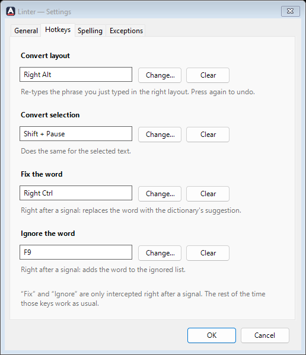
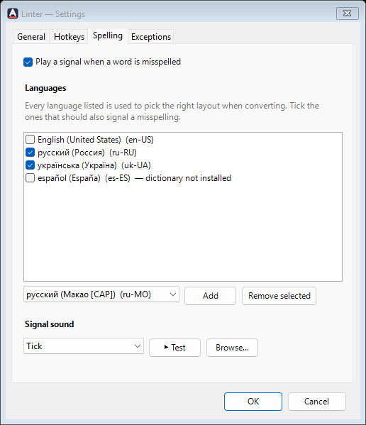
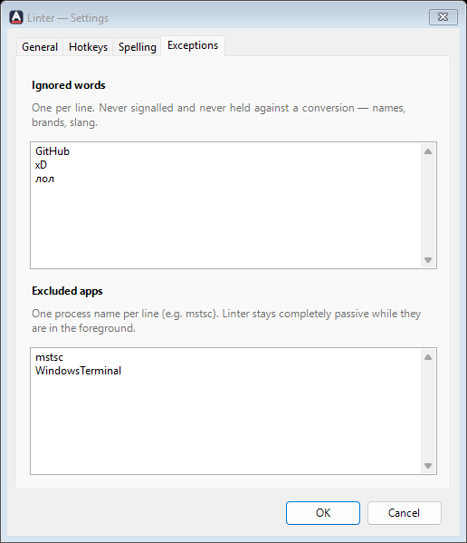
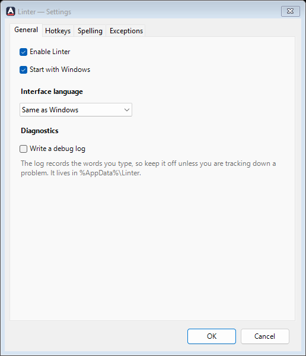

<p align="center">
  
</p>

# Linter

A small, native tray utility for Windows. Typed a sentence with the wrong keyboard layout on?
One key retypes it in the right one. It also gives a quiet signal when a word is misspelled,
and fixes it on request. C# / WinForms on .NET 8, no dependencies, never goes online.

**Website:** https://shimodos.github.io/linter-site/ · [Русская версия](README.ru.md)

<p align="center">
  
</p>

## Download

Grab the latest build from the [Releases](https://github.com/Shimodos/Linter/releases) page:

| File | What it is |
|---|---|
| `Linter-<version>-win-x64.zip` | **Recommended.** Self-contained: unzip anywhere and run `Linter.exe`. Nothing else to install. |
| `Linter-<version>-win-x64-framework.zip` | Small build (about 300 KB) that needs the [.NET 8 Desktop Runtime](https://dotnet.microsoft.com/download/dotnet/8.0). |

Windows 10 / 11, x64. No installer: unzip, run, and it appears in the tray. Keep the `Sounds`
folder next to `Linter.exe`. Settings live in `%AppData%\Linter`, so deleting the two folders
uninstalls it.

## Hotkeys

| Default | What it does |
|---|---|
| `Right Alt` | Retypes the phrase you just typed in the right layout and switches the layout. Press again to undo. |
| `Shift` + `Pause` | Does the same for the selected text. |
| `Right Ctrl` | Right after a signal: replaces the word with the dictionary's first suggestion. |
| `F9` | Right after a signal: adds the word to the ignore list. |

`Right Ctrl` and `F9` are only intercepted in the moment right after a signal, before you type
anything else. The rest of the time they reach the application untouched. Every hotkey can be
changed (press the key you want in Settings → Hotkeys) or cleared.

## Features

- **Whole phrases, not just a word.** Everything since the last full stop or Enter is converted in one go, spaces included.
- **Undo with the same key.** A second press restores the original text and the original layout.
- **Selected text too.** Select a line typed in the wrong layout an hour ago, press the hotkey, and it is converted in place.
- **A signal instead of a pop-up.** A short sound when a word is not in the dictionary. Nothing steals focus, nothing is auto-corrected.
- **One-key fix and one-key ignore.** Replace the typo with the dictionary's suggestion, or tell Linter the word is fine (a name, a brand, slang) and never hear about it again.
- **Any layout you have installed.** It uses the keyboard layouts and spelling dictionaries already in Windows. You choose which languages get the signal.
- **Eight sounds, or your own.** Tick, blip, pop, knock, double, drop, buzz, ding — all synthesized and license-free — the system beep, or any WAV file.
- **Stays out of chosen apps.** List the programs where it should do nothing at all: remote desktop, games, terminals.
- **Careful by design.** After a click, a window switch, an arrow key or a paste it forgets the phrase rather than risk editing the wrong text.
- **Private.** No network code, no account, no telemetry. The debug log is off unless you turn it on.
- **Three languages:** English, Ukrainian, Russian. Picked up from Windows, switchable in settings.
- **Start with Windows**, and a tray icon that turns grey when Linter is switched off.

<p align="center">
  
  &nbsp;&nbsp;
  
</p>
<p align="center">
  
  &nbsp;&nbsp;
  
</p>

## How it works

Linter installs one system-wide low-level keyboard hook. For every key press it keeps the
physical key and the modifiers held, not just the character produced. That is what lets it
replay the same presses under a different layout later.

- **Buffering.** Key presses accumulate into the current *phrase*: everything since the last
  hard boundary (Enter, punctuation). Spaces end a word but keep the phrase alive, so a whole
  sentence can be repaired in one shot.
- **Letting go.** The buffer describes the text before the caret in one window. Arrows,
  Home/End, Delete, a mouse click, a switch to another window, a shortcut such as Ctrl+V or
  Ctrl+Z — any of them drops it, because Linter can no longer be sure what is on screen.
- **Conversion.** On the hotkey the phrase is replayed under every *other* installed layout
  (`ToUnicodeEx`) and each result is spell-checked. The one with the most real words wins:
  Linter backspaces the original, switches the layout and types the winner. If no candidate
  has a real word but the text as it stands has none either (a wrong-layout word with a typo,
  `ghdbtn` → «првиет»), it is still moved to the other alphabet, where the typo can be fixed.
  Text that already reads as real words is never touched.
- **Selection.** For selected text there are no key presses to replay, so it works backwards:
  it asks each layout which keys would have typed those characters (`VkKeyScanEx`), replays
  them under the other layouts and keeps the best-spelled result, or leaves the text alone if
  it already reads fine. The text travels through the clipboard, whose previous text is put back.
- **Layout-aware spelling.** A word is judged only by the dictionary of the layout it was typed
  under. Russian and Ukrainian share an alphabet, and "any Cyrillic dictionary accepts it"
  would let a Russian typo pass whenever it happens to be a Ukrainian word. For the same
  reason a Cyrillic dictionary is never asked about Latin text.
- **Off the hook thread.** Spell checking (COM) and typing are never done inside the hook
  callback; they are posted to the message loop, so the hook returns at once and Windows never
  disables it. The mouse hook that notices clicks lives on its own thread for the same reason.

## Build from source

Requires the .NET 8 SDK and nothing else (no Visual Studio needed).

```bash
dotnet build src/Linter/Linter.csproj -c Release
```

Run from source, run the tests:

```bash
dotnet run --project src/Linter/Linter.csproj -c Release
```

```bash
dotnet test tests/Linter.Tests/Linter.Tests.csproj
```

Single-file build that needs the .NET 8 Desktop Runtime:

```bash
dotnet publish src/Linter/Linter.csproj -c Release -r win-x64 --self-contained false -p:PublishSingleFile=true -o publish
```

Fully self-contained build (about 60 MB zipped, no runtime needed):

```bash
dotnet publish src/Linter/Linter.csproj -c Release -r win-x64 --self-contained true -p:PublishSingleFile=true -p:IncludeNativeLibrariesForSelfExtract=true -o publish-standalone
```

Releases are built by [GitHub Actions](.github/workflows/release.yml) when a `v*` tag is pushed.

Spell checking needs the Windows dictionaries for your languages. Windows installs them with
each language: *Settings → Time & language → Language & region*.

## Project layout

| Folder | Contents |
|---|---|
| `src/Linter/Shell/` | tray icon, settings window, and the `ApplicationContext` that wires everything |
| `src/Linter/Keyboard/` | keyboard hook, mouse-click watcher, `SendInput`, layout switching, `ToUnicodeEx` |
| `src/Linter/Text/` | typed-key buffer and word-boundary rules (pure, unit-tested) |
| `src/Linter/Services/` | phrase and selection converters, spell checker, sound, autostart |
| `src/Linter/Configuration/` | settings model, hotkeys, JSON store |
| `src/Linter/Localization/` | interface strings (en / ru / uk) in one table |
| `src/Linter/Interop/` | P/Invoke signatures, structs, COM interfaces of the spell checker |
| `src/Linter/Assets/`, `Sounds/` | generated icons and signal sounds |
| `tests/Linter.Tests/` | xUnit tests; the ones that need Windows dictionaries skip themselves where absent |
| `tools/` | `gen-assets.js` (icons, sounds), `gen-demo.js` (the animation above), `snapshot` (settings screenshots) |

No third-party packages in the app. Each file owns one small responsibility; the project is
meant to be read top to bottom by humans, not just compiled.

## Files on disk

| File | Purpose |
|---|---|
| `%AppData%\Linter\settings.json` | settings; can be edited by hand |
| `%AppData%\Linter\debug.log` | diagnostic trace, **only if you enable it** — it records typed words |
| `%AppData%\Linter\crash.log` | unhandled exceptions |

"Start with Windows" is a value in the per-user `Run` registry key, not in the file.

<details>
<summary>Keys in <code>settings.json</code></summary>

| Key | Meaning |
|---|---|
| `languages` | dictionaries used to pick the right layout when converting |
| `spellCheckLanguages` | subset of `languages` that signals a misspelling |
| `ignoredWords` | words never signalled and never counted against a conversion |
| `excludedProcesses` | foreground process names (no `.exe`) where Linter stays passive |
| `soundFile` | a built-in name (`tick.wav`), a full path to your own `.wav`, or `null` for the system beep |
| `hotkeys` | `convert`, `convertSelection`, `fix`, `ignore`: a virtual-key code and a modifier mask each; key `0` switches the action off |
| `language` | interface language: `en`, `ru`, `uk`, or `auto` to follow Windows |
| `debugLog` | write the diagnostic trace |

</details>

## Adding a sound or a language

- **Sound:** drop a WAV into the `Sounds` folder next to `Linter.exe` and it shows up in the list. To ship one, add it to `tools/gen-assets.js` and run `node tools/gen-assets.js`.
- **Interface language:** add a column to the table in `Localization/Localizer.cs` and its code and name to `Languages` / `NativeNames`. A test checks that every string is translated.
- **Screenshots:** `dotnet run --project tools/snapshot -- docs/screenshots` renders the settings window in every language without starting the app.

## License

MIT
