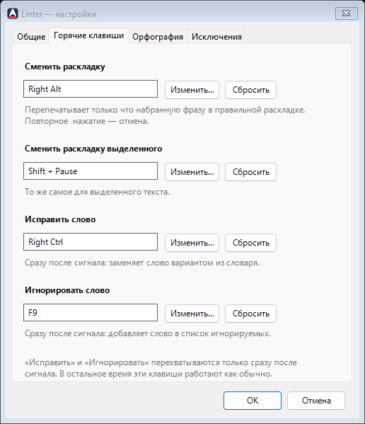
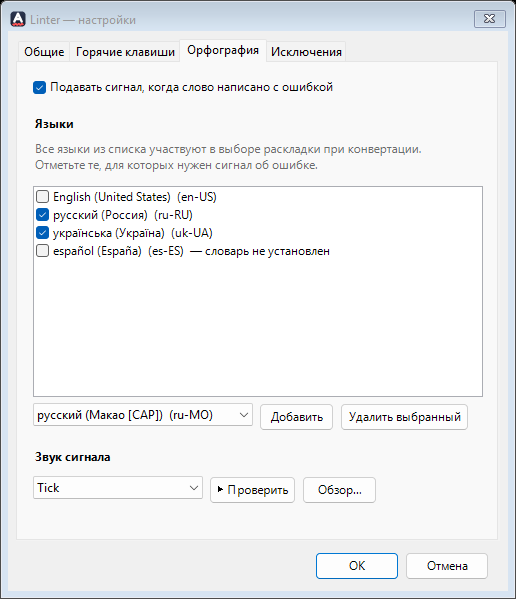
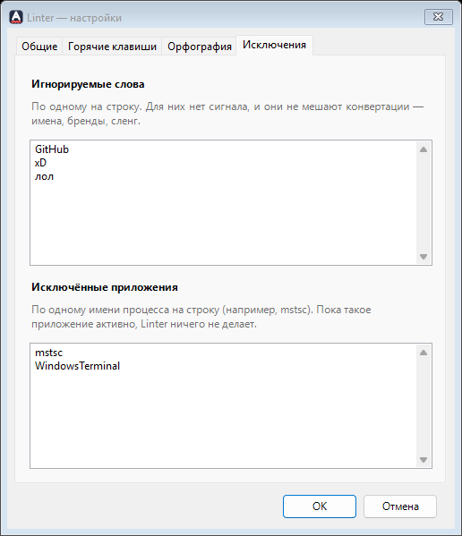
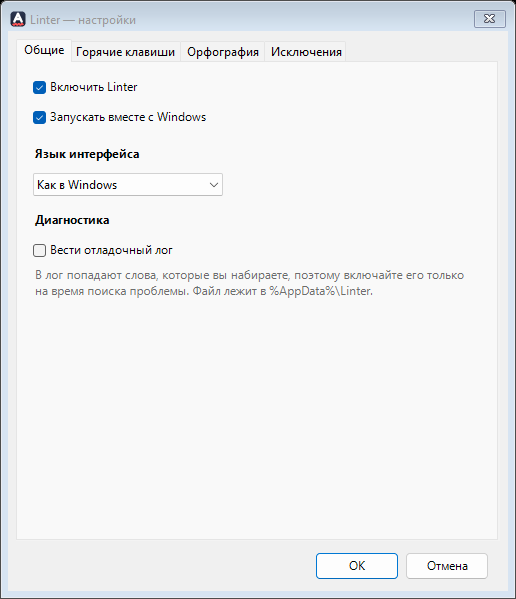

<p align="center">
  
</p>

# Linter

Маленькая нативная утилита для Windows, живёт в трее. Набрали фразу не в той раскладке?
Одна клавиша перепечатает её в правильной. Ещё она подаёт тихий сигнал, когда слово написано
с ошибкой, и исправляет его по запросу. C# / WinForms на .NET 8, без зависимостей, в сеть не ходит.

**Сайт:** https://shimodos.github.io/linter-site/ · [English version](README.md)

<p align="center">
  
</p>

## Скачать

Готовые сборки лежат на странице [Releases](https://github.com/Shimodos/Linter/releases):

| Файл | Что это |
|---|---|
| `Linter-<версия>-win-x64.zip` | **Рекомендуется.** Автономная сборка: распаковать и запустить `Linter.exe`, ничего ставить не нужно. |
| `Linter-<версия>-win-x64-framework.zip` | Маленькая сборка (около 300 КБ), нужен [.NET 8 Desktop Runtime](https://dotnet.microsoft.com/download/dotnet/8.0). |

Windows 10 / 11, x64. Установщика нет: распаковали, запустили — значок появился в трее. Папка
`Sounds` должна лежать рядом с `Linter.exe`. Настройки хранятся в `%AppData%\Linter`, так что
для удаления достаточно стереть обе папки.

## Горячие клавиши

| По умолчанию | Что делает |
|---|---|
| `Right Alt` | Перепечатывает только что набранную фразу в правильной раскладке и переключает раскладку. Повторное нажатие — отмена. |
| `Shift` + `Pause` | То же самое для выделенного текста. |
| `Right Ctrl` | Сразу после сигнала: заменяет слово первым вариантом из словаря. |
| `F9` | Сразу после сигнала: добавляет слово в список игнорируемых. |

`Right Ctrl` и `F9` перехватываются только в момент сразу после сигнала, пока вы не набрали
что-то ещё. В остальное время они доходят до приложения как обычно. Любую клавишу можно
поменять (нажмите нужную в «Настройки → Горячие клавиши») или сбросить.

## Возможности

- **Целые фразы, а не одно слово.** Конвертируется всё, что набрано после последней точки или Enter, вместе с пробелами.
- **Отмена той же клавишей.** Второе нажатие возвращает исходный текст и исходную раскладку.
- **Выделенный текст.** Выделите строку, набранную час назад не в той раскладке, нажмите клавишу — она исправится на месте.
- **Сигнал вместо всплывающего окна.** Короткий звук, когда слова нет в словаре. Фокус не перехватывается, ничего не исправляется само.
- **Исправить или игнорировать одной клавишей.** Заменить опечатку вариантом из словаря или сообщить, что слово правильное (имя, бренд, сленг), — и больше о нём не слышать.
- **Любая установленная раскладка.** Используются раскладки и словари, которые уже есть в Windows. Вы выбираете, для каких языков нужен сигнал.
- **Восемь звуков или свой.** Tick, blip, pop, knock, double, drop, buzz, ding — синтезированы скриптом, лицензий нет, — системный сигнал или любой WAV-файл.
- **Не мешает в выбранных программах.** Список приложений, где Linter вообще ничего не делает: удалённый рабочий стол, игры, терминалы.
- **Осторожность.** После клика, смены окна, стрелки или вставки он забывает фразу, а не рискует исправить не тот текст.
- **Приватность.** Нет сетевого кода, аккаунта и телеметрии. Отладочный лог выключен, пока вы сами его не включите.
- **Три языка интерфейса:** английский, украинский, русский. Берётся из Windows, меняется в настройках.
- **Запуск вместе с Windows** и значок в трее, который сереет, когда Linter выключен.

<p align="center">
  
  &nbsp;&nbsp;
  
</p>
<p align="center">
  
  &nbsp;&nbsp;
  
</p>

## Как это работает

Linter ставит один глобальный низкоуровневый хук клавиатуры. Для каждого нажатия он запоминает
физическую клавишу и зажатые модификаторы, а не только получившийся символ. Именно это позволяет
позже «проиграть» те же нажатия в другой раскладке.

- **Буфер.** Нажатия копятся в текущую *фразу* — всё, что набрано после последней жёсткой
  границы (Enter, знак препинания). Пробел заканчивает слово, но не фразу, поэтому целое
  предложение чинится за один раз.
- **Сброс.** Буфер описывает текст перед курсором в одном окне. Стрелки, Home/End, Delete,
  клик мышью, переход в другое окно, сочетание вроде Ctrl+V или Ctrl+Z — после любого из них
  буфер очищается: Linter уже не может быть уверен, что именно на экране.
- **Конвертация.** По горячей клавише фраза проигрывается во всех *остальных* установленных
  раскладках (`ToUnicodeEx`), и каждый результат проверяется по словарю. Побеждает вариант с
  наибольшим числом настоящих слов: Linter стирает исходный текст, переключает раскладку и
  печатает победителя. Если настоящих слов нет ни в одном варианте, но и исходный текст словом
  не является (слово в чужой раскладке да ещё с опечаткой, `ghdbtn` → «првиет»), он всё равно
  переводится в другой алфавит, где опечатку можно исправить. Текст из настоящих слов не трогается.
- **Выделенный текст.** Нажатий для него нет, поэтому работа идёт в обратную сторону: для каждой
  раскладки выясняется, какими клавишами можно было набрать эти символы (`VkKeyScanEx`), они
  проигрываются в остальных раскладках, и остаётся лучший по словарю вариант — либо текст не
  трогается, если он и так читается. Текст идёт через буфер обмена, прежнее содержимое возвращается.
- **Проверка с учётом раскладки.** Слово судит только словарь той раскладки, в которой оно
  набрано. У русского и украинского общий алфавит, и правило «подошёл любой кириллический
  словарь» пропускало бы русскую опечатку, если она случайно совпала с украинским словом.
  По той же причине кириллический словарь не спрашивают о латинице.
- **Не в потоке хука.** Проверка орфографии (COM) и печать никогда не выполняются внутри
  обработчика хука: они откладываются в цикл сообщений, хук возвращается сразу, и Windows его
  не отключает. Хук мыши, который замечает клики, по той же причине живёт в отдельном потоке.

## Сборка из исходников

Нужен только .NET 8 SDK (Visual Studio не требуется).

```bash
dotnet build src/Linter/Linter.csproj -c Release
```

Запуск из исходников и тесты:

```bash
dotnet run --project src/Linter/Linter.csproj -c Release
```

```bash
dotnet test tests/Linter.Tests/Linter.Tests.csproj
```

Сборка одним файлом, которой нужен .NET 8 Desktop Runtime:

```bash
dotnet publish src/Linter/Linter.csproj -c Release -r win-x64 --self-contained false -p:PublishSingleFile=true -o publish
```

Полностью автономная сборка (около 60 МБ в архиве, рантайм не нужен):

```bash
dotnet publish src/Linter/Linter.csproj -c Release -r win-x64 --self-contained true -p:PublishSingleFile=true -p:IncludeNativeLibrariesForSelfExtract=true -o publish-standalone
```

Релизы собирает [GitHub Actions](.github/workflows/release.yml) при пуше тега `v*`.

Для проверки орфографии нужны словари Windows для ваших языков. Windows ставит их вместе с
языком: *Параметры → Время и язык → Язык и регион*.

## Структура проекта

| Папка | Содержимое |
|---|---|
| `src/Linter/Shell/` | значок в трее, окно настроек и `ApplicationContext`, который всё связывает |
| `src/Linter/Keyboard/` | хук клавиатуры, слежение за кликами, `SendInput`, переключение раскладки, `ToUnicodeEx` |
| `src/Linter/Text/` | буфер набранных клавиш и правила границ слов (чистый код, покрыт тестами) |
| `src/Linter/Services/` | конвертеры фразы и выделения, проверка орфографии, звук, автозапуск |
| `src/Linter/Configuration/` | модель настроек, горячие клавиши, хранение в JSON |
| `src/Linter/Localization/` | строки интерфейса (en / ru / uk) одной таблицей |
| `src/Linter/Interop/` | сигнатуры P/Invoke, структуры, COM-интерфейсы проверки орфографии |
| `src/Linter/Assets/`, `Sounds/` | сгенерированные иконки и звуки сигнала |
| `tests/Linter.Tests/` | тесты xUnit; те, которым нужны словари Windows, сами пропускаются, если словарей нет |
| `tools/` | `gen-assets.js` (иконки, звуки), `gen-demo.js` (анимация в шапке), `snapshot` (скриншоты настроек) |

Сторонних пакетов в приложении нет. Каждый файл отвечает за одну небольшую вещь: проект
рассчитан на то, чтобы его читали люди, а не только компилятор.

## Файлы на диске

| Файл | Назначение |
|---|---|
| `%AppData%\Linter\settings.json` | настройки; можно править вручную |
| `%AppData%\Linter\debug.log` | отладочный лог, **только если вы его включили** — в него попадают набранные слова |
| `%AppData%\Linter\crash.log` | необработанные исключения |

«Запускать вместе с Windows» — это значение в пользовательском ключе реестра `Run`, а не в файле.

<details>
<summary>Ключи в <code>settings.json</code></summary>

| Ключ | Смысл |
|---|---|
| `languages` | словари, по которым выбирается раскладка при конвертации |
| `spellCheckLanguages` | те из `languages`, для которых подаётся сигнал об ошибке |
| `ignoredWords` | слова, для которых нет сигнала и которые не мешают конвертации |
| `excludedProcesses` | имена процессов (без `.exe`), в которых Linter ничего не делает |
| `soundFile` | имя встроенного звука (`tick.wav`), полный путь к своему `.wav` или `null` для системного сигнала |
| `hotkeys` | `convert`, `convertSelection`, `fix`, `ignore`: код виртуальной клавиши и маска модификаторов; клавиша `0` отключает действие |
| `language` | язык интерфейса: `en`, `ru`, `uk` или `auto` — как в Windows |
| `debugLog` | вести отладочный лог |

</details>

## Как добавить звук или язык

- **Звук:** положите WAV в папку `Sounds` рядом с `Linter.exe` — он появится в списке. Чтобы включить его в поставку, добавьте его в `tools/gen-assets.js` и запустите `node tools/gen-assets.js`.
- **Язык интерфейса:** добавьте столбец в таблицу в `Localization/Localizer.cs`, а код и название — в `Languages` / `NativeNames`. Тест проверяет, что переведена каждая строка.
- **Скриншоты:** `dotnet run --project tools/snapshot -- docs/screenshots` отрисовывает окно настроек на всех языках, не запуская приложение.

## Лицензия

MIT
